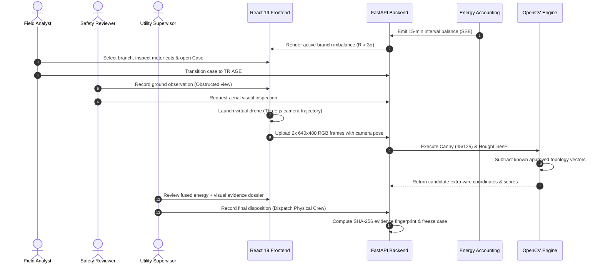

<div align="center">

# Grid Trace (विद्युत Trace)

### *Simulation-Backed Electricity Distribution Digital Twin & Explainable Loss Investigation Platform*

[](https://github.com/taruncodes07/IBM-Skillsbuild-National-Finale)
[](https://www.python.org/)
[](https://react.dev/)
[](https://www.typescriptlang.org/)
[](https://fastapi.tiangolo.com/)
[](https://threejs.org/)
[](https://opencv.org/)
[](https://www.langchain.com/)
[](https://www.docker.com/)
[](LICENSE)

<br/>

**Grid Trace** is an enterprise-grade digital twin and multi-agent investigation platform designed to localize, analyze, and document non-technical energy losses (NTL) in low-voltage electrical distribution networks. Built for the **IBM SkillsBuild National Finale**, the system bridges physical energy balance accounting, real-time 3D procedural simulation, simulated aerial computer vision, and auditable human-in-the-loop governance.

[Key Features](#-key-features) • [Architecture](#-system-architecture) • [Mathematical Model](#-mathematical--analytical-formulation) • [Quickstart](#-getting-started) • [Investigation Workflow](#-end-to-end-investigation-workflow) • [Verification](#-testing--verification-harness) • [Responsible AI](#-responsible-ai--ethical-guardrails)

</div>

---

## ⚡ Executive Summary & Motivation

### The Operational Challenge
In electrical distribution grids worldwide—and notably across emerging infrastructure where India's Ministry of Power reported aggregate technical and commercial (AT&C) losses of **15.04% for FY2024–25**—unaccounted energy loss erodes utility financial viability, strains transformer assets, and degrades power quality. Non-technical losses encompass unmetered physical taps, bypassed meters, instrumentation calibration drifts, and phase mapping errors. 

Traditional detection relies either on indiscriminate black-box machine learning models (which suffer from high false-positive rates and lack operational explainability) or expensive, unguided physical field patrols.

### The Grid Trace Solution
Grid Trace replaces guesswork with an **explainable, closed-loop forensic investigation platform**:

1. **Sectional Energy Accounting**: Ingests smart meter (AMI) telemetry, isolates topological cuts across feeders, distribution transformers, and low-voltage branches, and calculates physical residuals against quadratic conductor dissipation models.
2. **Deterministic Anomaly Localization**: Evaluates rolling $3\sigma$ residual bounds over consecutive time windows to flag the minimal observable network section.
3. **Next-Best Action Ranking**: Employs a multi-objective utility scoring engine that ranks follow-up checks (ground inspection, meter calibration, aerial drone dispatch) based on expected information gain, cost, and field accessibility.
4. **Targeted Simulated Aerial Computer Vision**: Dispatches a virtual drone equipped with calibrated cameras to capture high-resolution RGB imagery of overhead assets, passing frames to a headless OpenCV pipeline (Canny edge detection + Probabilistic Hough Transform) that filters approved conductor paths to isolate illegal overhead bypass taps.
5. **Multi-Agent Orchestration & Auditable Governance**: Leverages LangGraph workers with pluggable LLM backends (IBM Granite, Google Gemini, local Ollama) to synthesize diagnostic reports, enforce strict human-in-the-loop role separation (Analyst, Reviewer, Supervisor), and guarantee tamper-evident SHA-256 evidence ledgers.

> [!IMPORTANT]
> **Synthetic Demonstration & Ethical Disclaimer**: All assets, topology coordinates, time-series measurements, incidents, flight telemetry, and imagery rendered within Grid Trace are synthetic. Statistical energy residuals and computer vision candidates indicate anomalies requiring human investigation; they do not establish legal proof of theft, energization, or billing authorization.

---

## 🧭 Table of Contents

- [⚡ Executive Summary & Motivation](#-executive-summary--motivation)
- [✨ Key Features](#-key-features)
- [🏛️ System Architecture](#-system-architecture)
- [🔬 Mathematical & Analytical Formulation](#-mathematical--analytical-formulation)
- [💻 Tech Stack & Engineering Standards](#-tech-stack--engineering-standards)
- [🚀 Getting Started](#-getting-started)
  - [Prerequisites](#prerequisites)
  - [Option A: Docker Compose (Recommended)](#option-a-docker-compose-recommended)
  - [Option B: Bare-Metal Local Development](#option-b-bare-metal-local-development)
  - [Environment Configuration](#environment-configuration)
- [🔍 End-to-End Investigation Workflow](#-end-to-end-investigation-workflow)
- [📡 API Specification & Data Contracts](#-api-specification--data-contracts)
- [🧪 Testing & Verification Harness](#-testing--verification-harness)
- [🛡️ Responsible AI & Ethical Guardrails](#-responsible-ai--ethical-guardrails)
- [👥 Authors & Acknowledgments](#-authors--acknowledgments)

---

## ✨ Key Features

### 🌐 1. Interactive 3D Digital Twin (React 19 + Three.js / R3F)
- **Topologically Grounded Scenery**: Procedurally renders 2 primary feeders, 4 distribution transformers, 8 monitored branch sections, 24 household smart meters, and interconnecting service drop poles in an interactive WebGL viewport.
- **Bi-Directional Telemetry Binding**: Selecting an asset in 3D immediately isolates its analytical time-series, load curves, and historical variance.
- **Dynamic Anomaly Shading**: Visualizes active section alerts directly on network conductors using real-time shader color-ramping.

### 📊 2. High-Precision Energy Reconciliation Engine
- **Hierarchical Balance Cuts**: Computes instantaneous and interval residuals:
  $$R_t = E_{\text{in}, t} - \sum E_{\text{meter}, t} - E_{\text{auth}, t} - L_{\text{expected}, t}$$
- **Quadratic Technical Loss Modeling**: Accommodates load-dependent copper losses ($I^2R$) and continuous iron losses via calibrated $(a, b)$ loss coefficients per network tier.
- **Robust Outlier Resistance**: Employs rolling 7-day baselines (672 intervals at 15-minute resolution) and 3-streak sequential threshold gating to eliminate false positives from motor start surges or transient load spikes.

### 🎯 3. Next-Best Check Ranking Engine (`backend/ranking.py`)
- **Cost-Benefit Action Prioritization**: Evaluates diagnostic candidates (e.g., ground inspection, aerial inspection, phase verification, CT calibration) through a composite utility function:
  $$\text{Score} = w_1 \cdot \Delta H(\text{State}) - w_2 \cdot \text{Cost}_{\text{operational}} + w_3 \cdot \text{Safety} + w_4 \cdot \text{Urgency}$$
- **Hard Operational Prerequisites**: Prohibits drone flight authorization without prior ground verification documenting an obstructed line-of-sight and a clear overhead visual question.

### 🚁 4. Targeted Aerial Computer Vision Pipeline (`backend/inspection.py`)
- **Calibrated Virtual Drone Camera**: Executes a 15-second autonomous flight trajectory with two virtual camera perspectives ($640 \times 480$ RGB).
- **Masked Probabilistic Hough Line Detection**: 
  - Converts frames to grayscale and executes dual-threshold Canny edge detection ($45 / 125$).
  - Projects known, approved conductor vectors into camera screen coordinates using Three.js world-to-screen matrix transformations.
  - Applies a tolerance buffer ($\pm 7\text{ px}$) around approved paths to subtract known infrastructure.
  - Identifies anomalous, pole-attached line segments exceeding candidate length thresholds ($45\text{ px}$) as candidate unmetered bypass taps.

### 🤖 5. Multi-Worker Orchestration with LangGraph
- **Role-Specialized Workers (W1–W4)**:
  - **W1 (Telemetry Analyst)**: Ingests raw smart meter feeds, handles imputation, and validates balance cuts.
  - **W2 (Physical Forensics)**: Analyzes inspection imagery and computes geometric confidence scores.
  - **W3 (Utility Auditor)**: Reconciles billing logs, customer baseline shifts, and solar generation feeds.
  - **W4 (Executive Synthesis)**: Compiles structured incident dossiers for utility engineering review.
- **Multi-Model Transport Adapters**: Full runtime support for IBM Granite (`granite-3-8b-instruct`), Google Gemini, and local Ollama execution with graceful offline fallback fixtures.

### 🔒 6. Enterprise Case Management & Audit Ledger
- **State-Machine Lifecycle**: Enforces strict transitions: `TRIAGE` $\rightarrow$ `GROUND_REVIEW` $\rightarrow$ `FLIGHT_APPROVED` $\rightarrow$ `INSPECTED` $\rightarrow$ `DISPOSITION`.
- **Role-Based Access Control**: Simulated, cryptographically verified personas (`Analyst`, `Reviewer`, `Supervisor`) prevent unauthorized status escalations.
- **Tamper-Evident Evidence Storage**: SHA-256 fingerprinting for all uploaded raw PNG frames, annotated vision overlays, and exported case reports.

---

## 🏛️ System Architecture

```mermaid
flowchart TB
    subgraph Data Layer ["Data Ingestion & Simulation Layer"]
        Sim["Simulation Engine<br/>(backend/simulation.py)"]
        CSV["Sample Readings CSV<br/>(data/sample_readings.csv)"]
        Replay["Month Replay<br/>(2,880 intervals / Sept 2022)"]
    end

    subgraph Analytical Core ["Analytical & Reconciliation Core"]
        Topo["Topology Service<br/>(2 Feeders, 4 DTs, 8 Branches)"]
        Recon["Energy Accounting<br/>(backend/analytics.py)"]
        Loss["Technical Loss Model<br/>(a·Δt + b·kW²·Δt)"]
        Rank["Next-Best Action Ranking<br/>(backend/ranking.py)"]
    end

    subgraph Orchestration ["Agentic & CV Subsystems"]
        LG["LangGraph Multi-Worker Engine<br/>(Workers W1–W4)"]
        LLM["Model Adapters<br/>(IBM Granite / Gemini / Ollama)"]
        CV["OpenCV Vision Pipeline<br/>(Canny + HoughLinesP)"]
    end

    subgraph Presentation ["Operator Workspace (React 19 + TypeScript)"]
        Three["3D Digital Twin<br/>(Three.js / React Three Fiber)"]
        Drone["Virtual Drone Flight Rig<br/>(Calibrated Offscreen Capture)"]
        UI["Operations Console<br/>(Triage, Audit, Replay, Evidence)"]
    end

    subgraph Persistence ["Persistence & Governance"]
        SQLite[(SQLite Event Ledger<br/>data/gridtrace.db)]
        Artifacts[("Immutable PNG Vault<br/>(Raw & Annotated Images)")]
    end

    Data Layer --> Recon
    Topo --> Recon
    Loss --> Recon
    Recon --> Rank
    Recon --> LG
    LG --> LLM
    Rank --> UI
    Recon --> UI
    Three <--> Drone
    Drone -->|640x480 RGB Frames| CV
    CV -->|Candidate Scores| LG
    UI -->|Case Lifecycle & Reviews| Persistence
    LG --> Persistence
```

### End-to-End Telemetry & Inspection Sequence



---

## 🔬 Mathematical & Analytical Formulation

### 1. Sectional Energy Accounting
For any monitored topological section $k$ at time interval $t$ with duration $\Delta t = 0.25\text{ h}$:

$$R_{k,t} = E_{\text{in}, k, t} - \sum_{m \in \mathcal{M}_k} E_{m, t} - E_{\text{auth}, k, t} - L_{\text{loss}, k, t}$$

Where:
- $E_{\text{in}, k, t}$: Boundary energy imported into section $k$ (kWh).
- $\mathcal{M}_k$: Set of verified downstream consumer smart meters.
- $E_{\text{auth}, k, t}$: Declared authorized unmetered consumption (e.g., streetlights).
- $L_{\text{loss}, k, t}$: Empirical technical dissipation model.

### 2. Quadratic Conductor & Core Loss Approximation
Technical losses are calculated using a dual-term polynomial approximating load-independent iron losses and load-dependent resistive copper dissipation:

$$L_{\text{loss}, k, t} = \left( a_k + b_k \cdot P_{\text{downstream}, k, t}^2 \right) \cdot \Delta t$$

| Network Tier | No-Load Parameter $a$ ($\text{kW}$) | Conductor Parameter $b$ ($1/\text{kW}$) | Physical Meaning |
| :--- | :--- | :--- | :--- |
| **Branch Line (LT)** | $0.035$ | $0.0012$ | Low-voltage service drop resistance |
| **Transformer Secondary** | $0.045$ | $0.00012$ | Low-voltage busbar & substation cabling |
| **Feeder to Transformer** | $0.080$ | $0.00004$ | MV conductor resistance & core magnetization |

### 3. Anomaly Decision Boundary
An active branch alert is triggered if and only if the calculated residual satisfies:

$$R_{k,t} > \Theta_{k,t} \quad \text{for } 3 \text{ consecutive complete valid intervals}$$

$$\Theta_{k,t} = \max\left( 0.25\text{ kWh},\; 0.08 \cdot E_{\text{in}, k, t},\; 3\cdot\sigma_{\text{clean}, k} \right)$$

Where $\sigma_{\text{clean}, k}$ is the section-specific residual standard deviation established across a 7-day clean baseline (floored at $0.015\text{ kWh}$). Missing or corrupted telemetry resets the sequential counter to zero, preventing false triggers during network brownouts.

---

## 💻 Tech Stack & Engineering Standards

| Layer | Component | Version | Engineering Rationale |
| :--- | :--- | :--- | :--- |
| **Frontend Core** | React | `19.0.0` | Latest concurrent rendering primitives, zero legacy lifecycle hooks |
| **Language** | TypeScript | `5.7.3` | Strict null checking, end-to-end interface contracts matching backend Pydantic models |
| **3D Rendering** | Three.js / R3F | `0.175.0` / `9.1.2` | High-performance WebGL digital twin, offscreen canvas target rendering for virtual drone capture |
| **Build Tooling** | Vite | `6.4.5` | Sub-second HMR, optimized tree-shaking and ES module production bundling |
| **Backend Framework** | FastAPI | `0.135.3` | Async ASGI runtime, automatic OpenAPI v3 documentation, high throughput |
| **Computer Vision** | OpenCV Headless | `4.13.0.92` | Ultra-fast headless Canny edge extraction and Hough Line geometry analysis |
| **Numerical Processing** | NumPy | `2.4.3` | Vectorized time-series reconciliation and residual variance computation |
| **Agent Orchestration** | LangGraph | `1.2.17` | Cyclic state-graph multi-worker orchestration with typed state channels |
| **Storage & Audit** | SQLite | `3.x (WAL)` | Single-file transactional ACID storage with write-ahead logging and zero cloud dependencies |
| **Containerization** | Docker Compose | Multi-Stage | Distroless production builds, isolated persistence volumes, zero host contamination |

---

## 🚀 Getting Started

### Prerequisites
- **Python**: `3.12+` (tested through `3.14`)
- **Node.js**: `20.19+` (reference environment: Node `24.x`, npm `11.x`)
- **Docker**: Docker Desktop (optional, for containerized deployment)

---

### Option A: Docker Compose (Recommended)

To launch the complete production stack (pre-compiled frontend + FastAPI backend) in isolated containers:

```bash
# Clone the repository
git clone https://github.com/taruncodes07/IBM-Skillsbuild-National-Finale.git
cd IBM-Skillsbuild-National-Finale

# Launch via Docker Compose
docker compose up --build -d
```

Once running, access the application at:
- **Web Application**: [http://127.0.0.1:8080](http://127.0.0.1:8080)
- **Interactive OpenAPI Docs**: [http://127.0.0.1:8080/docs](http://127.0.0.1:8080/docs)

To stop the containers while preserving case data:
```bash
docker compose down
```

---

### Option B: Bare-Metal Local Development

#### 1. Automated Start (Windows PowerShell)
```powershell
.\start.ps1
```
The script automatically builds the virtual environment, installs locked Python packages, resolves npm dependencies, compiles the Vite production bundle, and launches Uvicorn on `http://127.0.0.1:8000`.

#### 2. Manual Step-by-Step (Cross-Platform)

```bash
# 1. Initialize Python virtual environment
python -m venv .venv

# Activate environment:
# On Windows:
.\.venv\Scripts\activate
# On Linux/macOS:
source .venv/bin/activate

# 2. Install pinned dependencies
pip install -r requirements.lock.txt

# 3. Install frontend dependencies and build
npm ci --no-audit --no-fund
npm run build

# 4. Launch the FastAPI server
uvicorn backend.main:app --host 127.0.0.1 --port 8000
```

#### 3. Live Frontend Development
For hot-reloading frontend development, keep the backend running on port `8000` and start Vite in a separate terminal:
```bash
npm run dev
```
Open the Vite dev server at [http://127.0.0.1:5173](http://127.0.0.1:5173). Vite automatically proxies API requests (`/api`, `/evidence`) to the FastAPI backend.

---

### Environment Configuration

Copy `.env.example` to `.env` to configure optional runtime parameters:

```ini
# Server Configuration
HOST=127.0.0.1
PORT=8000
GRIDTRACE_DATA=./data

# Model Providers (Optional - Mock fixtures used if unset)
IBM_GRANITE_API_KEY=
WATSONX_PROJECT_ID=
GEMINI_API_KEY=
OLLAMA_ENDPOINT=http://127.0.0.1:11434
```

---

## 🔍 End-to-End Investigation Workflow

```
[1. Inject Scenario] ➔ [2. Detect Imbalance] ➔ [3. Triage Case] ➔ [4. Ground Check] ➔ [5. Aerial Inspection] ➔ [6. CV Analysis] ➔ [7. Disposition]
```

1. **Initialize Scenario**: Open the **Simulation Laboratory** (Flask icon). Select `Visible unmetered load` with random seed `42`. Step the simulation forward 3 intervals (or engage 10× playback).
2. **Observe Anomaly**: At interval 1, an unmetered bypass begins on `branch-03`. By interval 3, the residual exceeds threshold criteria ($R > \Theta$), triggering an active alert.
3. **Triage Case**: In the role of **Demo Analyst**, assign an investigator and transition the case status to `TRIAGE`.
4. **Conduct Ground Review**: Switch persona to **Demo Reviewer**. File a mandatory ground observation note (e.g., *"Conductor obscured behind foliage; overhead service drop unconfirmed from street level"*).
5. **Execute Aerial Drone Mission**: With ground prerequisites satisfied, approve the drone flight. The 3D viewport animates a 15-second virtual flight, automatically capturing two calibrated $640 \times 480$ offscreen RGB frames.
6. **Inspect Computer Vision Evidence**: The backend OpenCV engine runs edge extraction and vectors subtraction, highlighting candidate anomalous wires with geometric confidence scores.
7. **Supervisor Disposition**: Switch to **Demo Supervisor**. Formulate final disposition (`DISPATCH_CREW` or `INCONCLUSIVE`), affixing cryptographic SHA-256 evidence digests, and export full audit records as JSON/Markdown.

---

## 📡 API Specification & Data Contracts

Grid Trace provides a comprehensive, RESTful OpenAPI v3 compliant backend:

| Method | Endpoint | Description | Role Required |
| :--- | :--- | :--- | :--- |
| `POST` | `/api/runs` | Initialize a new simulation or replay session | `operator` |
| `GET` | `/api/runs/{id}/snapshot` | Fetch synchronized state (topology, clocks, readings, cases) | `any` |
| `POST` | `/api/runs/{id}/control` | Play, pause, step, or adjust simulation speed (1×, 10×, 60×) | `operator` |
| `GET` | `/api/runs/{id}/events` | Real-time Server-Sent Events (SSE) stream for telemetry | `any` |
| `POST` | `/api/cases` | Create an investigation case from an active alert | `analyst` |
| `PATCH`| `/api/cases/{id}` | Update case status, notes, or assigned investigator | `analyst` / `reviewer` |
| `POST` | `/api/cases/{id}/missions` | Dispatch aerial drone inspection mission | `reviewer` |
| `POST` | `/api/missions/{id}/frames` | Upload raw RGB frames captured by virtual camera | `system` |
| `GET` | `/api/cases/{id}/export` | Export full auditable case dossier (`json` or `markdown`) | `any` |
| `GET` | `/evidence/{filename}` | Stream immutable original and annotated PNG artifacts | `any` |

---

## 🧪 Testing & Verification Harness

Grid Trace enforces strict test-driven development and mathematical verification standards across all modules:

```bash
# Execute complete backend pytest suite (101 unit and integration tests)
pytest -v

# Execute frontend flight and recovery unit tests
npm run test:client

# Execute PRD gap verification script
python verify_prd_gaps.py

# Execute independent deterministic B0/B1 baseline evaluation
python tests/benchmark_independent.py
```

### Verification Metrics
- **Backend Test Suite**: **101 passed** (including CSV regressions, topology boundary validation, ranking prerequisites, and SSE streaming).
- **Client Test Suite**: **13 passed** (covering camera flight routes, WebGL context loss recovery, and state serialization).
- **TypeScript & Bundler**: Zero type errors (`tsc --noEmit`), clean Vite production build.
- **Vulnerability Audit**: Zero vulnerabilities reported via `npm audit`.

---

## 🛡️ Responsible AI & Ethical Guardrails

Grid Trace was designed from the ground up under strict utility governance principles:

1. **No Automated Accusation or Enforcement**: System detections represent statistical indicators and visual candidate cues intended solely to guide human investigators. No automatic disconnections, bill penalties, or public notices can be generated.
2. **Accountability & Separation of Duties**: Critical operational actions (approving drone flights, dismissing an alert, closing a case) require explicit persona role transitions (`Analyst` $\rightarrow$ `Reviewer` $\rightarrow$ `Supervisor`).
3. **Preservation of Alternative Hypotheses**: The analytics engine explicitly flags benign explanations—such as meter under-registration, sensor communication failures, and phase rebalancing—before considering unmetered consumption.
4. **Synthetic Data Boundaries**: No real-world customer PII, smart meter records, or geographic GIS coordinates are utilized.

---

## 👥 Authors & Acknowledgments

Developed by **Team Grid Trace** for the **IBM SkillsBuild National Finale 2026**:
- **Abhinandan** ([@abhi8667](https://github.com/abhi8667))
- **Tarun** ([@taruncodes07](https://github.com/taruncodes07))
- **Sudeepti Sagar** ([@SudeeptiSagar](https://github.com/SudeeptiSagar))
- **Saish Ambar** ([@ambarsaish](https://github.com/ambarsaish))

### Core References & Frameworks
- India Ministry of Power, Aggregate Technical & Commercial (AT&C) Loss Reporting FY2024–25.
- Bureau of Energy Efficiency (BEE), *Guidelines for Annual Energy Audits in Electricity Distribution Companies*.
- OpenCV Foundation, *Probabilistic Hough Line Transform Implementation Guide*.
- React Three Fiber & Drei Ecosystem documentation.

---

<div align="center">
<sub>Built with precision, integrity, and engineering rigour for the IBM SkillsBuild National Finale.</sub>
</div>
