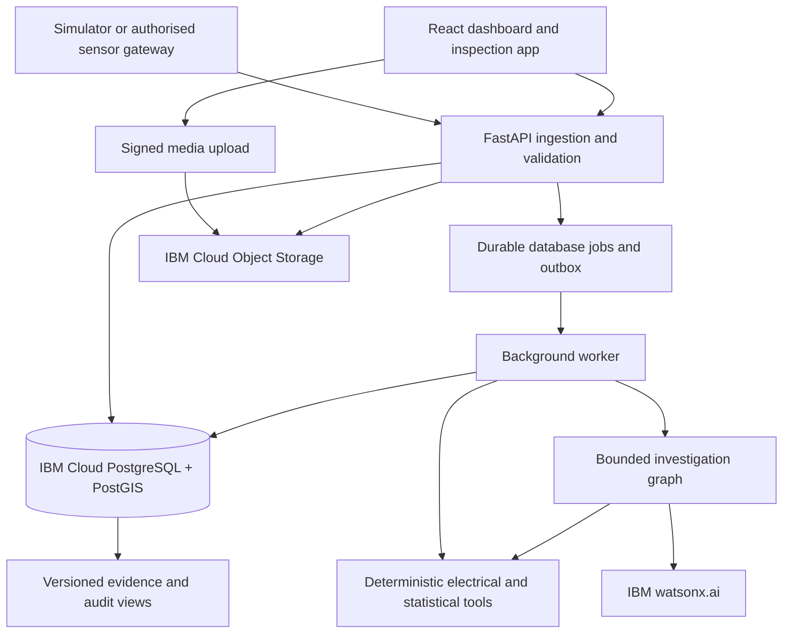

# Build plan: electricity monitoring and evidence-based inspection app

Prepared 22 October 2026. This plan extends `electricity-theft-monitoring-feature-specification.md` with a concrete simulation, implementation sequence, IBM architecture, testing gates and stronger multi-agent design. It specifies the work; it does not claim the app is already implemented. No cost estimates are included.

## 1. What we will deliver

A working web application that replays a simulated distribution network, identifies measurement and accounting anomalies, investigates competing explanations with specialist agents, and connects alerts to drone/ground inspection evidence and human findings.

The complete first release includes:

- A reproducible numerical simulation with known answers kept outside the detection system.
- A real backend and persistent database, rather than a dashboard with hard-coded outcomes.
- Authenticated data ingestion, validated measurements, electrical topology and energy accounting.
- An interactive map, time replay, detailed charts, case management and evidence viewer.
- A multi-agent investigation that requests and tests evidence, not just exchanges opinions.
- Sensor adapters and drone evidence integration with clear mock/live status.
- IBM watsonx.ai integration and IBM Cloud deployment.
- Automated checks, failure recovery, monitoring and documented limitations.

Do not promise zero software errors. Define observable acceptance criteria, test failure paths and make the system degrade safely. An anomaly remains a suspicion until a suitable inspection establishes its cause.

## 2. Start with a concrete simulated area

### 2.1 Area and assets

Create **BLR-SIM-01**, a fictional roughly 1 km² Bengaluru-style mixed residential/commercial neighbourhood. Its names, geometry, loads and events are synthetic, not BESCOM records or actual allegations.

- One 11 kV feeder as the source context.
- Three 11/0.415 kV transformers: T01 and T02 rated 250 kVA; T03 rated 160 kVA.
- Four low-voltage branches per transformer: B01–B12.
- Twenty-five customer connections on each branch: 300 connections total.
- One transformer-output meter per transformer, 12 branch-inlet meters and 300 customer meters: **315 metering devices**.
- Initial electrical model: radial three-phase, four-wire low-voltage network, phase assignments, neutral, conductor length/impedance, load power factors and transformer parameters.
- Nominal 415 V line-to-line; actual voltages and currents come from the electrical solver in the full simulation. A nominal value must never be presented as a measured voltage.

Within each transformer group, start with 80 residential, 16 commercial and four public-service connections. Vary customers and layouts for independent simulation runs. Treat this mix as an experimental assumption, not a survey.

### 2.2 Dataset size and resolution

Generate 90 days, 1 January–31 March 2026, using 15-minute energy-accounting intervals. This gives 8,640 intervals and **2,721,600 scheduled device-interval records** before deliberately missing telemetry is removed. Measurement rows use the actual observed channel availability.

Generate separate high-resolution windows only for power-quality or EM experiments. Fifteen-minute averages cannot represent brief transients. Do not generate 90 days of waveform data unnecessarily.

Replay uses a simulation clock, with pause, speed control, single-interval stepping and reset. Never use wall-clock time to decide whether replayed readings are stale; evaluate freshness relative to the selected replay clock.

### 2.3 Numerical starting snapshot

Use one 15-minute interval to test the accounting before building charts or agents. Begin with branch authorised active powers:

- T01: B01 = 80 kW; B02 = 60 kW; B03 = 45 kW; B04 = 35 kW.
- T02: B05 = 50 kW; B06 = 40 kW; B07 = 35 kW; B08 = 25 kW.
- T03: B09 = 40 kW; B10 = 30 kW; B11 = 25 kW; B12 = 25 kW.

For this **arithmetic fixture only**, branch technical energy loss is fixed at 2% of authorised energy. Transformer-output meters are directly upstream of branch-inlet meters, with zero intervening loss in this simplified fixture. Transformer internal losses are outside the monitored LV boundary.

The normal totals are 122.5 kWh of customer consumption, 2.45 kWh of branch losses and 124.95 kWh supplied during the interval. T01 supplies 56.10 kWh; T02 supplies 38.25 kWh; T03 supplies 30.60 kWh. These values are handcrafted accounting examples, not outputs from a power-flow solver.

Inject two distinct problems:

1. **B07 unmetered load:** add 6 kW, or 1.50 kWh, during the interval. Its authorised consumption stays 8.75 kWh; fixture loss stays 0.175 kWh; measured input becomes 10.425 kWh. Residual: 1.50 kWh. T02 rises to 39.75 kWh. Loss changes caused by additional current are deliberately excluded from this toy fixture and must be included in the full solver dataset.
2. **B11 branch-meter gain error:** true input is 6.375 kWh, but the branch meter reports 12% too high, or 7.140 kWh. Customer consumption remains 6.25 kWh. The branch residual is 0.765 kWh. T03's output does not rise, so transformer-to-branch accounting shows an opposite −0.765 kWh mismatch. That contradiction should prompt a measurement check, not a theft accusation.

The public snapshot therefore contains evidence for two anomalies but no exposed event labels. True source supply is 126.45 kWh. The evaluator can check both answers; the application and agents cannot read the evaluator truth.

An accompanying starter pack contains this snapshot, topology, device records and a separate evaluator-only answer file. It is not the full 90-day electrical simulation and has no genuine drone images or measured EM fields.

### 2.4 Full simulation generation

Use EPRI OpenDSS for quasi-static time-series power flow. Generate customer load profiles in Python and apply them to an explicit network model. OpenDSS is designed for distribution power flow and sequential time simulations. [EPRI introduction](https://opendss.epri.com/IntroductiontoOpenDSS.html), [power-flow documentation](https://opendss.epri.com/PowerFlow.html).

For every run:

1. Store the seed, area ID, scenario configuration and solver version.
2. Create customer profiles with morning/evening residential peaks, commercial schedules, weekends, load diversity and independent variation. Avoid making every theft case a single obvious consumption drop.
3. Solve the true network at each interval, checking convergence, equipment ratings and physical energy conservation.
4. Record actual branch/transformer energies, phase currents, voltages, power factors and losses.
5. Apply meter noise, configuration faults, time shifts and telemetry outages in an observation layer separate from physical truth.
6. Produce the public telemetry and operational records available at that point in time.
7. Store injected events, true losses, unmetered loads and inspection ground truth in a separate evaluator store.

The detector uses an approximate network/loss model with documented uncertainty. It must not receive the simulator's perfect loss values, hidden meter errors or undisclosed events. Include model misspecification to avoid an unrealistically easy inverse problem.

### 2.5 Required scenario library

Cover normal variation; legitimate large demand; rooftop solar and reverse flow; technical loss increase; meter gain error; CT ratio/polarity error; clock drift; missing/duplicated/delayed telemetry; meter replacement/reset; switching/topology changes; an authorised unmetered load; bypassed consumption; hidden additional load; intermittent theft; and theft combined with a sensor fault.

Choose event magnitudes relative to the branch load and uncertainty. Include low-magnitude cases where the correct result is inconclusive. Vary start times, durations, branches and recurrence; do not encode labels in filenames, IDs, image annotations or prompt text.

Operational information must be released at plausible times. A newly reported switching event can explain an alert only after its report becomes available. Inspection outcomes cannot appear before the inspection occurs.

### 2.6 Splits and ground truth

For initial development use days 1–54 for training/baselines, 55–72 for validation and 73–90 for final time-based evaluation. Keep complete event episodes on one side of a split; purge overlap from rolling windows.

Before claiming generalisation, generate additional independent neighbourhood layouts and seeds; hold entire layouts and event combinations out of development. Repeated windows on one branch are correlated observations, not independent cases. SGCC data may inform a separate customer-behaviour experiment, but must not be joined to synthetic feeder rows as if they describe the same system.

## 3. System architecture

Use a **modular monolith plus a separate worker** initially. This keeps accounting transactions and case workflows understandable without creating a fleet of microservices.



The browser communicates with the API, not directly with the database or watsonx. The API and worker share domain modules, schemas and migrations. Independent model/tool execution stays outside HTTP request lifetimes.

## 4. IBM services and integration decisions

### 4.1 watsonx.ai

Use watsonx.ai for specialist assessment and concise evidence-grounded explanations. Use a model available in the selected account and region that passes tool-calling and output-schema tests. Do not hard-code a remembered model name as a permanent dependency.

Put the official Python client behind a small provider adapter. Configure endpoint, project/space, model ID, output limits and concurrency through server-side configuration. Refresh IAM credentials through supported mechanisms; never put an API key in frontend code.

Use an explicit orchestration graph, such as LangGraph, with persisted checkpoints and typed tool contracts. IBM documents tool-calling workflows and a LangGraph integration path. [IBM chat/tool documentation](https://www.ibm.com/docs/en/watsonx/saas?topic=agents-agent-driven-chat), [IBM LangGraph tutorial](https://developer.ibm.com/tutorials/awb-build-tool-calling-agents-with-langgraph-and-flows-engine/).

Model/schema capabilities vary. Validate tool arguments and outputs server-side even when the model supports structured output. If native schema output is unavailable, use the supported tool-output mechanism plus strict parsing and one bounded repair attempt. An invalid response is a failed assessment, not usable evidence.

Provide recorded/mock responses for deterministic CI and an opt-in live watsonx integration suite. Label mock-agent mode prominently; it cannot establish actual multi-agent performance.

### 4.2 IBM-hosted application database

Use **IBM Cloud Databases for PostgreSQL**, with PostGIS, for telemetry indexes, topology, cases, user scopes, jobs and review metadata. This meets the IBM database-hosting requirement while retaining standard SQL and geospatial tooling. IBM lists PostGIS among supported extensions; verify compatibility with the provisioned database version. [Extension documentation](https://cloud.ibm.com/docs/databases-for-postgresql?topic=databases-for-postgresql-extensions).

Use native PostgreSQL partitioning and indexes; do not assume a time-series extension is available. Keep an application connection pool small enough for all API and worker replicas combined. A database service's high availability does not replace application retry, restore tests or regional recovery planning. [IBM availability and recovery](https://cloud.ibm.com/docs/databases-for-postgresql?topic=databases-for-postgresql-postgresql-ha-dr).

If the project specifically requires an IBM-developed database engine rather than an IBM-hosted service, evaluate Db2 in a separate technical spike. PostgreSQL is the selected initial implementation; replacing it changes SQL, driver and geospatial assumptions. Do not run two primary databases without a demonstrated need.

### 4.3 Object Storage

Use IBM Cloud Object Storage for immutable original evidence, media derivatives, raw batch files, dataset manifests and evaluation exports. Upload media through short-lived, case-scoped signed URLs, then validate it before marking it ready. [IBM signed URLs](https://cloud.ibm.com/docs/cloud-object-storage/hmac?topic=cloud-object-storage-presign-url).

Keep originals separate from redacted images and annotations. Use versioning and an approved retention policy; evaluate Object Lock where retention requirements justify it. A hash demonstrates file consistency, not that an image's contents or metadata are true. [IBM Object Lock](https://cloud.ibm.com/docs/cloud-object-storage?topic=cloud-object-storage-ol-overview).

### 4.4 Hosting with Code Engine

Host a containerised frontend and API on IBM Cloud Code Engine. Run the long-lived queue consumer as an appropriate daemon job, with leases and graceful shutdown, instead of relying on an API process's background task. Use finite jobs for imports, simulations and controlled evaluations. [Daemon-job documentation](https://cloud.ibm.com/docs/codeengine?topic=codeengine-job-daemon).

Keep all durable state in PostgreSQL/Object Storage. Account for cold starts; use a minimum API instance during demos and active pilots if required. Polling is the initial progress mechanism, avoiding dependency on indefinite browser connections. [Scaling configuration](https://cloud.ibm.com/docs/codeengine?topic=codeengine-app-scale).

Use service bindings/secrets and verify private connectivity where supported. Bindings supply configuration/credentials; they do not automatically solve database routing or permissions. [Service bindings](https://cloud.ibm.com/docs/codeengine?topic=codeengine-service-binding), [service endpoints](https://cloud.ibm.com/docs/codeengine?topic=codeengine-serviceendpt).

### 4.5 Provisioning gate

Before coding against cloud dependencies, create a small integration spike: authenticated API → PostgreSQL/PostGIS → Object Storage upload/download → watsonx tool call → persisted worker job. Verify service/model availability, quotas, region compatibility, data residency and deployment permissions. Do not assume every service is available in an Indian region. [watsonx regional availability](https://www.ibm.com/docs/en/watsonx/saas?topic=services-regional-availability-features).

Add further IBM services only after a concrete requirement appears. Do not require watsonx Orchestrate, a vector database or a streaming platform merely to make the architecture look more agentic.

## 5. Backend implementation

### 5.1 Modules and persistence

Use FastAPI, typed request/response models, SQLAlchemy and Alembic migrations. Pin tested dependency versions and commit lockfiles. Group domain modules as identity, assets/topology, telemetry, accounting/detection, investigations, agent review, inspections/evidence and audit.

Core tables:

- `areas`, `assets`, `devices`, `device_config_versions`, `topology_versions`, `connections`.
- `ingestion_batches`, `measurements`, `quality_issues`, `operational_events`.
- `calculation_runs`, `section_balances`, `alerts`, `cases`.
- `evidence_snapshots`, `agent_runs`, `agent_assessments`, `tool_results`.
- `inspections`, `flights`, `evidence_objects`, `annotations`, `findings`, `actions`.
- `jobs`, `job_attempts`, `outbox_events`, `audit_events`, `user_area_roles`.

Every operational record has an area scope and source provenance. Measurements have interval boundaries, observed/received times, units, quality and device-configuration versions. Use decimal energy arithmetic at accounting boundaries; electrical solvers can use floating point with explicit tolerances.

Keep raw data immutable. Use unique idempotency keys and device/interval/revision constraints. A corrected reading is a new revision, not a silent overwrite. Separate findings, recommended dispositions and legal statuses into different fields.

### 5.2 Ingestion contract

Start with a versioned JSON/CSV import and authenticated HTTPS telemetry batch endpoint. The same validation path serves simulator and live gateway data. Device IDs and secrets are managed separately from operator credentials.

Require source ID, device ID, measurement interval, units, channel semantics and sequence/idempotency metadata. Make ambiguous fields such as `power=100` invalid. Define consumption/import as positive and export as negative, or carry separate import/export fields consistently.

Return accepted, duplicate and quarantined counts with structured reasons. Quarantine suspect records rather than discarding them. Use an event-time watermark and mark results provisional until enough late readings arrive; a proposed initial allowance is two accounting intervals, configurable by data source.

### 5.3 Durable processing and jobs

Use a database-backed queue initially: atomic job creation with an outbox event, row locking/leases, attempt counters, retry backoff and dead-letter status. Workers must be safe under at-least-once execution. Persist each graph step and evidence snapshot.

For AI reviews, reserve a run ID and record request/result hashes. If a provider timeout occurs after generation, an idempotent app retry can avoid duplicate stored findings, but cannot guarantee the provider did not perform or charge for the first request. Bound retries and reconcile uncertain attempts.

### 5.4 Deterministic accounting

Calculate each explicit boundary separately. At a transformer, compare its output with branch inlets, without subtracting customer use again. At a branch, compare inlet energy with signed net customer consumption, accounted authorised unmetered demand and estimated branch loss.

Calculate uncertainty from meter specifications, coverage, timing and loss-model uncertainty. Shared systematic errors are correlated; do not blindly combine all errors as independent Gaussian noise.

A candidate rule for development is a positive residual exceeding its uncertainty allowance in three of four valid intervals. This is a tunable starting rule, not a validated field threshold. Low coverage or unbounded topology uncertainty blocks a confident theft recommendation. Electrical safety events take a separate fast path and do not wait for agent review.

### 5.5 API surface

- Authentication/session and `GET /me`.
- Assets, topology, device health and bounded measurement queries.
- Dataset imports, simulation scenarios and replay controls.
- Section balances, alerts and case creation.
- Review jobs, review progress and structured assessments.
- Inspection requests, signed evidence uploads, annotations and findings.
- Supervisor decisions, follow-up comparisons and permitted audit export.

Publish OpenAPI and generate frontend types from it. All mutations require authorised state transitions, concurrency/version checks and request IDs. Use stable error codes for validation, insufficient data, stale case versions, provider limits and unavailable dependencies.

## 6. Multi-agent system that earns its complexity

### 6.1 Design principle

Different names and prompts alone are insufficient. Each specialist gets a different investigative objective, appropriate tools and a falsifiable question. The shared case snapshot prevents cherry-picking; tool access is scoped, and cross-examination exposes contradictory evidence.

Do not run multiple agents on every reading. Deterministic checks handle routine intervals; cheap quality checks handle obvious failures; contested/high-priority cases enter the full investigation graph.

### 6.2 Specialist responsibilities

1. **Measurement investigator:** verifies clock/coverage/configuration and requests raw counter comparisons. Tools: coverage audit, counter-reset detection, time-offset comparison and device-ratio history. Its output can block a confident theft assessment until measurement reliability is addressed.
2. **Electrical investigator:** tests whether topology, phase load, technical losses, solar or operational changes explain the residual. Tools: historical topology lookup, approximate power-flow rerun and loss-sensitivity calculation.
3. **Unauthorised-load investigator:** tests whether unaccounted consumption persists across valid intervals and adjacent boundaries. Tools: residual localisation, change-point comparison and recurrent-pattern analysis. It must state what would falsify its hypothesis.
4. **Inspection investigator:** assesses available camera/field evidence, source timing, asset association and EM calibration. It cannot infer authorisation from appearance. It runs only when inspection evidence exists; absence of an image is not negative evidence.
5. **Independent challenger:** attacks the currently favoured explanation, checks evidence reuse and requests the most discriminating additional test. It examines both pro-theft and non-theft claims.
6. **Adjudication step:** a deterministic policy gate validates citations, missing-data blocks and allowed outcomes; an optional synthesis agent explains the surviving assessment. No majority vote overrides failed evidence checks.

All specialists see a common factual baseline and can request other authorised facts through logged tools. No agent can read simulator truth, arbitrary SQL, unrestricted files or unapproved network resources.

### 6.3 Investigation graph

`freeze evidence → quality triage → independent specialist assessments → identify disputed claims → select discriminating tool checks → execute checks → one challenge/revision round → policy gate → concise synthesis → human queue`

Set a maximum of six specialist/synthesis initial calls plus four targeted follow-up calls, 12 tool invocations and a configurable wall-clock limit, initially 120 seconds. Run independent specialist calls concurrently under provider limits; execute dependent checks in order. If work exceeds the budget, persist progress and return a partial review.

Store tool outputs and brief claim/rationale summaries, not a performance of endless conversation or private chain-of-thought. Maintain a structured claim ledger: claim, evidence IDs, counterevidence, unresolved question, test result and revision.

### 6.4 Counterfactual checks

Use tools to test questions such as:

- Does correcting a plausible CT gain error remove the local residual and the opposite upstream mismatch?
- Does accounting for known solar export remove the discrepancy?
- Does shifting a misaligned stream improve balances across several boundaries?
- Does the residual survive the highest credible technical-loss estimate?
- Does an extra-load hypothesis explain the measurements better than a single faulty sensor?

Fit or select hypotheses on one subset of intervals and test them on a later/held-out interval set. Simply tuning a correction until one residual vanishes is not evidence of the true cause.

Rank the next measurement by expected ability to separate hypotheses and inspection effort. Initially use transparent rules rather than an unvalidated information-gain formula. Examples: cross-check a branch meter when parent/child errors oppose each other; inspect an overhead branch when all reliable boundaries support extra consumption.

### 6.5 Required structured output

Each assessment records `case_id`, `snapshot_id`, `agent_role`, `model_id`, `prompt_version`, hypotheses, cited evidence, counterevidence, assumptions, tool requests/results, unresolved questions and an allowed recommendation.

Recommendations are `measurement_check`, `operational_or_equipment_check`, `monitor`, `inspection_recommended`, or `insufficient_evidence`. An agent cannot return `confirmed_theft`. A human inspection finding is stored through a different endpoint.

Any numerical score must come from a validated external scoring/calibration method. LLM self-confidence is not a theft probability. Store source dependence so a chart, another agent's summary and a raw reading derived from the same meter do not count as three independent observations.

### 6.6 Prove it is better than a single agent

Run a preregistered comparison on identical held-out cases:

- A: deterministic rules/statistics only.
- B: one strong agent with the same available evidence and tools.
- C: multi-agent review without cross-examination.
- D: the full tool-driven challenge workflow.

Give B a comparable total tool/token budget and an opportunity to revise. Otherwise a benefit may simply come from spending more compute. Also report unrestricted latency/cost comparisons separately.

Measure inspection precision at a fixed inspection capacity, false theft suspicions on fault cases, recall on planted theft where ground truth is known, abstention rate, correct requests for missing evidence, valid citations, latency and provider usage. Repeat nondeterministic runs and estimate uncertainty by independent event/network groups, not individual correlated windows.

An initial go/no-go target is at least a 20% relative reduction in false theft suspicions at recall within five percentage points of B, without hiding excessive abstention or exceeding the agreed review budget. This is a proposed target, not a promised result. Check sample-size adequacy before claiming it is met. If D does not improve outcomes, keep the simpler workflow and route only difficult cases through specialists.

The B11 gain-error case should demonstrate the intended benefit: a local positive residual initially resembles extra load; the measurement/electrical checks expose the opposite upstream mismatch; the challenger requests a meter cross-check; the final recommendation changes to measurement verification.

## 7. Interactive UI specification

Use React, TypeScript and a consistent component system. Prefer IBM Carbon styling for an IBM-oriented presentation, MapLibre for mapping, and a chart library with zoom/brush support. Verify licences and lock compatible versions during implementation.

### 7.1 Main workspace

Desktop layout: compact navigation, large central network map and a contextual side panel. Filters cover area, transformer, alert type, confidence/quality status and time window. Selecting an asset updates all related charts and case details.

Show explicit `SIMULATED`, `LIVE`, `MOCK AI`, `PROVISIONAL` and `STALE` indicators. A demonstration must never look like a live utility feed by accident.

### 7.2 Simulation controls

Provide dataset/seed selection, play/pause, speed, interval stepping and a timeline scrubber. A scenario builder can inject events in the simulation workspace; these controls and truth overlays are unavailable to operational users and agents. Changing a scenario creates a new run, never mutates an existing evaluation run.

### 7.3 Asset and alert detail

Show incoming energy, outgoing energy or customer net consumption, estimated technical losses, unexplained energy and uncertainty bands with units and interval definitions. Provide raw/derived toggles and compare-before/after views. Avoid smoothing away short events without labelling the transformation.

Map colouring shows section-level investigation priority, not a precise offender location. Use patterns/icons/text in addition to colour. Charts support keyboard navigation, readable tooltips and accessible contrast.

### 7.4 Investigation room

Display competing hypothesis cards with cited evidence and counterevidence, the tools actually run, the test results and why recommendations changed. Show unresolved disagreements and partial review status. Do not make an animated debate the primary output.

An operator can open a cited reading/chart, request a rerun on a new snapshot, assign inspection or ask for missing data. Human decisions require a reason and correct role permissions.

### 7.5 Inspection workspace

Provide an assignment list, location/asset checklist, camera evidence upload, annotations and a mobile-friendly field form. Keep flight approval status distinct from inspection assignment. Allow ground inspection when drone access is unsuitable.

Support compressed preview, resumable/retryable uploads and local draft preservation where feasible. Restrict offline caching of sensitive data; show last sync and resolve conflicting edits explicitly.

### 7.6 Reliability states

Every screen must handle loading, no matching data, permission denial, partial intervals, API failure and expired evidence links. Preserve filters in the URL. Use paginated lists and server-side aggregation; never load millions of readings into the browser. Map/tile-provider failure must leave a functional asset list and topology view.

## 8. Sensors and drones: actual integration boundaries

### Sensors

The simulator and gateway adapter emit the same normalised contract. Implement a gateway emulator first, then integrate a bench meter with read-only access before utility equipment. Keep per-device capability declarations; do not require voltage/current channels a meter cannot provide.

Buffer offline measurements and retry with sequence numbers. Monitor gateway clock drift and packet provenance. MQTT, where needed, terminates in an appropriate broker/gateway; do not host a persistent broker inside an autoscaled HTTP service by assumption.

### Drone camera

First release supports manually uploaded flight logs, photos and videos with time, coordinates, asset link and operator notes. Real flight automation is a separate authorised integration. Camera vision can suggest a connection to inspect, but authorisation requires records/field confirmation.

### Drone EM

Store magnetic vectors, sample timing, calibration, sensor axes, drone position/orientation, conductor geometry and interference metadata. EM data stays behind an experimental feature flag until bench and controlled-flight comparisons establish uncertainty. A failed calibration blocks its use as current evidence, but does not block camera inspection.

Do not claim a simulated field map validates real airborne sensing. Keep synthetic media and synthetic EM datasets visibly labelled and separate from real inspection evidence.

## 9. Reliability, security and tests

### Core checks

- Unit and property tests for units, sign conventions, boundary accounting, counter rollover and replay determinism.
- Simulator conservation/convergence checks and separate tests of the approximate detector loss model.
- Database integration tests for revisions, uniqueness, leases, state transitions and area-level authorisation.
- Agent contract tests for invalid JSON, fabricated citations, timeout, rate limits, missing tools and unavailable watsonx.
- Upload tests for file limits, metadata mismatch, object authorisation, interrupted uploads and malicious text embedded in evidence.
- Browser end-to-end tests for import → replay → alert → review → inspection → finding → follow-up.
- Restore and worker-crash tests so acknowledged imports and case decisions survive restarts.

Treat uploaded content as data, not instructions. Never let agent tools execute arbitrary code or SQL. Restrict file types, inspect content, quarantine originals until checks pass, and use least-privilege service identities. Protect both human endpoints and sensor endpoints; agent read-only policy is enforced by backend permissions, not prompts.

### Proposed release gates

- Starter fixture accounting matches expected decimals; full solver runs pass conservation checks within documented tolerance.
- Replaying an identical batch creates no duplicate logical measurements, alerts or case transitions.
- No known critical correctness/security failure, no unhandled exception in the critical demo journey, and all required checks pass.
- Every displayed agent citation resolves to permitted evidence; invalid results are rejected or marked incomplete.
- AI outage leaves telemetry, balances, alerts and case viewing functional.
- Proposed performance target: p95 interactive read APIs under 750 ms at 20 concurrent users on a specified staging configuration; measure, do not assume.
- Load test 10,000 devices, one record/15 minutes: roughly 11 records/second average, plus a 10-minute recovery burst and realistic queries. Test bulk imports independently.
- Provisional recovery targets: restore durable processing within 30 minutes and a recoverable-data gap under 15 minutes, subject to configured backup/PITR capability and field buffering. Prove these in a restore exercise before committing them.

For perspective, 25,000 continuously reporting devices would produce 2.4 million records/day and 216 million in 90 days. The 315-device demo is not evidence of city-scale capacity. Archive raw files, partition telemetry and benchmark retention/queries before expansion.

## 10. Likely problems and concrete fixes

### No matched Bengaluru theft dataset

Use synthetic truth for software validation, public data only for the tasks it supports, and a utility-approved local pilot for field performance. Never describe synthetic accuracy as demonstrated city accuracy.

### Anomalies are physically indistinguishable

A faulty customer meter and bypassed consumption may create the same aggregate signature. Expose the ambiguity, request an independent meter/inspection check and allow an inconclusive result. More agents cannot create missing information.

### Perfect simulation makes detection unrealistically easy

Separate physical truth from observation noise and approximate model knowledge. Hold out layouts, vary noise/parameters and include overlapping faults and low-magnitude cases.

### False positives from timing, CT ratios or wrong network maps

Use metadata/version checks, matched intervals, uncertainty gating and parent/child consistency tests. Require corroboration before escalation and route meter issues separately.

### Agents all agree on a wrong answer

Give them different tests and tool objectives, keep their first assessments independent, enforce evidence checks and benchmark against a well-resourced single agent. Do not use majority vote or fabricated confidence percentages.

### watsonx returns unsupported model/tool/schema errors

Run a capability probe during the cloud spike and deployment. Use a configuration-driven model selection, typed adapter and recorded integration tests. Fail visibly and retain deterministic alerts.

### Rate limits, slow reviews or duplicated AI work

Queue reviews, cap concurrency and budgets, cache immutable tool results, collapse repeat alerts into cases, checkpoint graph steps and display partial progress. Do not retry indefinitely.

### Cloud hosting stops background processing

Use durable leases and an appropriate daemon worker; keep long processing out of request handlers. Reclaim expired leases and test restart behaviour. Watch job quotas and clean up completed finite jobs.

### Database storage or connection pressure

Partition by time, index by area/device/time, aggregate on the server, batch writes, pool connections and use bounded retention. Add an external queue/streaming service only when measured backlog justifies it.

### Drone imagery is unavailable or ambiguous

Deliver the full manual upload and ground-inspection workflow first. Defer learned visual detection until there is labelled evidence. A visible extra wire can be authorised and must be checked.

### EM measurements are dominated by aircraft/geometry effects

Calibrate, separate sensor and aircraft interference, capture position/orientation and compare with reference instruments. Disable EM influence if validation fails; retain camera inspections.

### UI looks impressive but has fake behaviour

Implement one vertical slice against the real API/database before polishing every screen. Show job/error states, persistence across reloads, and numbers traceable to original readings. Label all mocks.

### Manual decisions are changed or cases disappear

Use append-only audit events, versioned decisions, role checks and supervisor reasons for closure/reopening. Track overdue cases and require explanations without asserting that delay proves corruption.

### IBM regional/residency or quota mismatch

Resolve region and data-processing approvals before uploading sensitive data. Use pseudonymised synthetic fixtures until the architecture is approved. If no acceptable managed-model region is available, assess a permitted deployment option or pause only that integration rather than silently exporting real data.

## 11. Repository structure

```text
apps/web/                    dashboard, maps, charts and field forms
services/api/                HTTP API, auth and domain modules
services/worker/             ingestion, detection and review job runners
packages/contracts/          versioned schemas and generated client types
simulation/                  network model, profiles, injection and replay
agents/                      graph, typed assessments, prompts and tools
evaluation/                  protected truth, baselines and comparison harness
infrastructure/              local containers and IBM deployment configuration
tests/                       integration, failure, security and browser checks
docs/                        architecture decisions and operations runbooks
```

Use separate environment configuration for local, CI, staging and production. No secrets, simulator answer keys or unrestricted evidence are shipped in browser assets or model prompts.

### Authentication and local development

Use an OpenID Connect identity provider for operator login, with an approved production provider selected during the IBM spike. Local containers may use a development provider with seeded roles. IBM Cloud IAM service credentials do not automatically authenticate application users. Use an appropriate authorization-code flow, secure HttpOnly session cookies, CSRF protection for cookie-authenticated mutations, and server-side area/role checks. Test horizontal access across areas as well as role restrictions.

Provide local containers for web, API, worker, PostgreSQL/PostGIS, S3-compatible development storage and the development identity provider. A documented bootstrap creates the schema, seeds the fictional area and imports public fixture files only. The evaluation command imports the answer key into a separately protected evaluator context. CI must exercise the same database and contract path used in cloud staging; a mock-only frontend is not sufficient.

Pin and validate a Linux-compatible OpenDSS runtime/Python interface in the simulation container. Do not assume a Windows COM-only integration works in IBM Cloud. Run a small known circuit on the actual target container before generating the full dataset.

## 12. Delivery sequence

Indicative schedule: 10–12 weeks for a small team, dependent on skills, IBM access and hardware availability. Progress by acceptance gate rather than calendar alone.

1. **Week 1 — contracts and IBM spike:** choose data conventions, make the starter fixture pass, create the repository, verify watsonx/PostgreSQL/Object Storage/Code Engine connectivity and define interface contracts.
2. **Weeks 2–3 — simulation and data foundation:** OpenDSS model, profiles, hidden scenario injection, reproducible dataset export, ingestion, topology and migration tests. Exit with a valid 90-day replay and conservation report.
3. **Weeks 4–5 — core vertical slice:** deterministic balances, uncertainty, alerts, actual map/charts and persistent cases. Exit with a normal case, gain-error case and suspected extra-load case traceable end to end.
4. **Weeks 6–7 — specialist investigation:** tools, independent assessments, challenge graph, watsonx adapter, citation checks, baseline/evaluation harness and investigation UI. Exit with measured comparison results, not a staged conversation.
5. **Weeks 8–9 — inspections and interfaces:** manual drone upload, field forms, evidence handling, sensor gateway emulator and optional bench device. EM parsing is included; validated EM localisation is a later research gate.
6. **Weeks 10–11 — deployment and hardening:** IBM staging deployment, failure/load/access tests, backups/restore, observability and runbooks. Exit with a repeatable end-to-end demo and deployment rollback.
7. **Week 12 — evaluation and handover:** report limitations, compare agents, prepare operator walkthrough and define utility pilot data requirements. Hardware/field claims require their own measured evidence.

## 13. Final demonstration and completion criteria

The finished demonstration must show a believable normal network, an unexplained-load case and a non-theft fault case. The operator can change time, inspect measured numbers, run specialist tests, see why the recommendation differs, upload inspection evidence, record a human finding and compare subsequent readings.

All displayed values come from stored datasets or explicit calculations. Restarting the app preserves data and case state. Disabling watsonx demonstrates useful fallback. A missing device and a failed media upload demonstrate recovery. Agent results can be traced to actual tools and evidence.

The multi-agent feature is complete only when its contribution is measured against the single-agent alternative. The sensor/drone integrations are complete only to the level actually demonstrated and labelled. The app is ready for a field pilot after these gates pass; it is not automatically validated for enforcement or city-wide operation.
